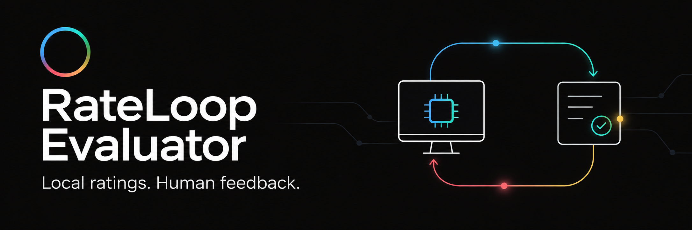

# RateLoop Evaluator

**Rate text against your own questions. Learn from human feedback. Run on your hardware.**

An Apache-2.0 evaluator built around GLiNER2.5 multilingual, with English and German support.
Use it independently or connect it to [RateLoop](https://www.rateloop.ai).

[Quick start](#quick-start) · [Connect to RateLoop](docs/operations.md#connect-your-computer) · [Documentation](#documentation)

## What it does

- **Local ratings:** evaluate predefined or custom text questions through an authenticated API.
- **Private learning:** fine-tune on authorized human feedback, compare candidates, and explicitly promote a model.
- **Controlled execution:** pinned model files, encrypted feedback storage, signed bundles, and rollback.

Ratings are advisory. Raw scores are not calibrated confidence, and AI never replaces a required human review.
Inference and training permissions are separate; your examples and adapted models are not public by default.

## Quick start

Use **Python 3.12**. Provisioning downloads the model once; inference uses local files without a cloud fallback.

```sh
git clone https://github.com/Noc2/rateloop-evaluator.git
cd rateloop-evaluator
python3.12 -m venv .venv
.venv/bin/python -m pip install -e '.[model,test]'
.venv/bin/rateloop-evaluator provision --model-dir "$HOME/rateloop-models/gliner25"
```

Then choose how to run it:

| Goal | Guide |
| --- | --- |
| Try the standalone API | [Start the service and send a sample request](docs/operations.md#run-locally) |
| Use your computer for RateLoop ratings | [Pair a device and start its worker](docs/operations.md#connect-your-computer) |
| Generate answers with Ollama | [Connect an existing local model](docs/operations.md#generate-with-your-local-ollama-model) |
| Improve ratings with your examples | [Import data, train, and compare](docs/learning.md) |

Native macOS supports Apple GPU acceleration. CPU and CUDA are explicit alternatives; see
[installation and hardware requirements](docs/operations.md#installation-choices).
Connecting a local model to RateLoop still sends workspace content through the hosted application.

## Documentation

| Guide | Contents |
| --- | --- |
| [Operations](docs/operations.md) | Setup, custom questions, background workers, deployment, and recovery |
| [Connector](docs/connector.md) | Model registration, permissions, review modes, and result delivery |
| [Learning](docs/learning.md) | Human feedback, datasets, calibration, and promotion gates |
| [Interface](contracts/INTERFACE.md) | Request/result contracts and [TypeScript client](clients/typescript/index.ts) |
| [Verification](docs/verification.md) | Measured results, tested hardware, and remaining quality checks |

Ollama-based judging is [experimental](docs/operations.md#experimental-local-generative-judge).
Successful execution or a synthetic benchmark does not establish rating accuracy.

## Development

Use Node.js 24 alongside the Python environment above. Default tests use synthetic fixtures and download no models.

```sh
.venv/bin/python scripts/check_contracts.py
.venv/bin/python -m pytest -q
.venv/bin/python -m build
```

See [contributor boundaries](AGENTS.md) and [security guidance](SECURITY.md).
Code is [Apache-2.0](LICENSE); model weights and datasets have their own licenses.
